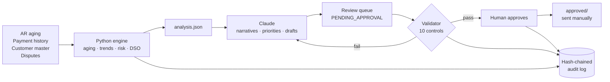

# collections-agent

**An open-source Claude Code agent that runs AR collections the way a good collections analyst would. It ranks overdue accounts by risk, flags customers whose payment behavior is getting worse, calculates DSO and cash-at-risk, and drafts tone-appropriate collection emails that a human approves before anything goes out.**

Part of an order-to-cash (O2C) agent series. All data is synthetic, for the fictional **Lumina Streaming Co.**

> Python does the math. Claude does the judgment. A human approves every email. Nothing is sent automatically.

---

## What it does

| | |
|---|---|
| **Prioritizes the worklist** | Ranks every past-due account by risk-weighted expected loss, not just by balance size. A $300K invoice that is one day late doesn't outrank a 108-day-old balance. |
| **Flags deteriorating payers** | Compares how late a customer paid in the last 90 days with the 9 months before. It catches a customer slipping from 15 to 45 days late, and customers who have stopped paying. |
| **Drafts emails in four tone tiers** | Friendly reminder (1–30 days) → firm follow-up (31–60) → escalation to the account owner and finance leader (61–90) → final notice with a credit-hold recommendation (90+). |
| **Routes disputes correctly** | Disputed invoices go to the dispute owner, never into a dunning email. |
| **Calculates AR metrics** | DSO, Best Possible DSO, Average Days Delinquent, a 6-month DSO trend, cash-at-risk, and expected loss. |
| **Writes the run report** | Executive summary, rationale for each account, watchlist narratives, dispute next steps, and hold recommendations for the controller. |

See a full example in [`examples/sample-run/`](examples/sample-run/): the [run report](examples/sample-run/run_report.md) and [13 email drafts](examples/sample-run/review_queue/).

---

## 5-minute quickstart

**You need:** Python 3.10+ and [Claude Code](https://docs.claude.com/en/docs/claude-code/overview). No other packages to install (standard library only).

```bash
# 1. Get the code (1 min)
git clone https://github.com/kamilkolacek/collections-agent.git
cd collections-agent

# 2. Run the deterministic analysis (10 sec)
python -m collections_agent analyze
```

You'll see something like:

```
Run 2026-10-31_122013  (as of 2026-10-31)
  Total AR $2,939,942 | past due $1,655,927 (56%) | DSO 74.4 (best possible 32.5, ADD 41.9)
  Cash at risk $693,842 | expected loss $175,362
  Worklist 13 | disputes 2 dispute-only | deteriorating 5 | hold recommended 3

  Rank  Customer                     Tier         Past due     Risk   Trend
     1  Horizon Sports Network       final          $499,709   63.2  DETERIORATING
     2  Northwind Media Partners     firm           $371,387   30.9  DETERIORATING
     3  Polaris Fitness Studios      final           $37,661   65.3  DETERIORATING
   ...
```

```bash
# 3. Let Claude do the judgment work (3 min)
claude
> /collections-run
```

Claude reads the analysis, drafts an email for every worklist account, validates each draft against 10 controls, and writes a run report. Then it stops and waits for you.

```bash
# 4. You review and approve (a person, in a terminal)
python -m collections_agent status
python -m collections_agent approve C-1003 --by "Your Name"
```

Approved drafts are copied to `output/runs/<run_id>/approved/`. Send them from your own mail client.

```bash
# 5. Check the evals pass
python -m unittest discover tests -v
```

---

## How it works



| Python: deterministic, unit-tested | Claude: judgment |
|---|---|
| Aging buckets and days past due | Risk narrative for each customer |
| Days-late trend and deterioration flag | Prioritization rationale and next steps |
| Risk score 0–100 with component breakdown | Email drafting in the right tone |
| Tone tier (from the oldest undisputed past-due item) | Escalation and credit-hold recommendations |
| Dispute routing | Dispute-handling recommendations |
| DSO, BPDSO, ADD, cash-at-risk, expected loss | Run report and executive summary |
| Draft validation, approval, audit log | Flagging where policy output looks wrong |

Every policy threshold (tier boundaries, the trend threshold, risk weights, hold rules, reserve rates) lives in one file, [`collections_agent/config.py`](collections_agent/config.py), so a controller can review the policy without reading code.

---

## Controls

Collections emails go to customers, so they get the same control discipline as a journal entry.

1. **No auto-send.** There is no send function anywhere in the codebase, and an eval checks for that. Drafts go to a review queue with status `PENDING_APPROVAL`.
2. **Human-only approval.** `approve` and `reject` require an interactive terminal, are blocked for Claude in `.claude/settings.json`, and refuse self-approval by the drafter.
3. **Validation before approval.** A draft can't be approved unless it passes all 10 controls:

   | # | Control |
   |---|---|
   | C1 | Only customers with undisputed past-due items get a dunning email |
   | C2 | Tone tier matches the computed tier |
   | C3 | Only undisputed past-due invoices are requested |
   | C4 | No disputed invoice number appears anywhere in the draft |
   | C5 | Amount requested ties to the listed invoices and appears in the body |
   | C6 | Every listed invoice is named in the body |
   | C7 | Correct recipient; account owner cc'd on escalation and final notices |
   | C8 | Credit-hold language appears only when policy recommends a hold, and must appear when it does |
   | C9 | No legal-threat language (legal action, collection agency, credit bureau, and similar) |
   | C10 | Status discipline (no self-approval, no approval without an approver) |

4. **Audit log for each run.** Every analysis, validation, approval and rejection is appended to `audit_log.jsonl`, with input-file SHA-256 hashes and a hash chain. `python -m collections_agent verify-log` detects tampering.
5. **Fail loudly on bad data.** Unknown customers, duplicate invoices, open amounts above the original, and disputes on invoices not in the aging all stop the run.

---

## Evals

[`EVALS.md`](EVALS.md) lists 25 known test cases with expected results, such as *"a customer trending from 15 to 45 days late must be flagged"* and *"a disputed invoice must route to dispute handling, not dunning"*. Each deterministic case is an automated test in [`tests/test_evals.py`](tests/test_evals.py). Judgment cases (tone, rationale) have a review rubric.

---

## Metric definitions

| Metric | Definition |
|---|---|
| **DSO** | Total open AR ÷ credit sales in the last 90 days × 90 |
| **Best Possible DSO** | Current (not yet due) AR ÷ last-90-day sales × 90 |
| **Average Days Delinquent (ADD)** | DSO − Best Possible DSO: the part collections can fix |
| **Cash at risk** | Past-due AR on High-risk accounts + all disputed balances |
| **Expected loss** | Σ open balance × reserve rate by bucket (2% / 10% / 25% / 50% for 1–30 / 31–60 / 61–90 / 90+) |
| **Priority value** | Expected loss on undisputed past-due items × (1 + risk score / 100) |
| **Deteriorating** | Average days late on payments in the last 90 days is ≥ 10 days worse than the prior 9 months, or no payments in 90 days while past due |
| **Risk score** | Aging severity (30) + oldest past-due (20) + trend (20) + credit utilization (15) + chronic lateness (10) + open dispute (5). High ≥ 45, Medium ≥ 25 |

---

## Commands

| Command | What it does |
|---|---|
| `/collections-run` | Full run: analyze → drafts → validate → run report |
| `/prioritize` | Ranked worklist with a rationale for each account |
| `/watchlist` | Deteriorating customers with risk narratives |
| `/draft-emails [IDs]` | Draft or redraft emails into the review queue |
| `/ar-metrics` | DSO, BPDSO, ADD, cash-at-risk, DSO trend |
| `/dispute-queue` | Dispute-handling recommendations |
| `/review-status` | Queue status, validation results, audit-log check |

CLI: `python -m collections_agent {analyze | customer | validate | status | approve | reject | verify-log}`

---

## The demo data

Twenty fictional Lumina Streaming Co. B2B customers (ad agencies, hotel chains, airlines, cable operators, gyms), with 13 months of invoices and payments, as of **October 31, 2026**. Each eval scenario is built into the data: a customer sliding from 15 to 45 days late, a chronically late but stable payer, an enterprise account that stopped paying after a partial payment, a customer with one disputed and one undisputed invoice, and more.

```
data/customer_master.csv    segment, credit limit, terms, account owner, AP contact
data/ar_aging.csv           open invoices as of 2026-10-31
data/payment_history.csv    paid invoices, Oct 2025 – Oct 2026
data/disputes.csv           open disputes
```

Regenerate with `python scripts/generate_data.py` (deterministic, fixed seed).

**To use your own data**, export the same four files from your ERP (NetSuite, SAP, Workday, and so on) with the column names above, then run `python -m collections_agent analyze --data path/to/folder`.

---

## Repo layout

```
CLAUDE.md                    agent instructions and hard rules
.claude/commands/            slash commands
.claude/settings.json        permission guardrails (approve/reject/data edits denied)
collections_agent/           deterministic engine (config, calc, engine, review_queue, audit, cli)
templates/                   email tone guide, run report template
data/                        synthetic inputs
examples/sample-run/         a complete example run (analysis, drafts, report, audit log)
tests/test_evals.py          automated evals
EVALS.md                     eval cases and expected results
```

---

## Disclaimer

Demo project with synthetic data. It's not legal or accounting advice. Collections communications may be subject to laws and contract terms in your jurisdiction, so review your policy with your controller and counsel before using anything like this with real customers.

MIT License · Built by [Kamil Kolacek](https://www.linkedin.com/in/kamil-kolacek) with Claude Code.
